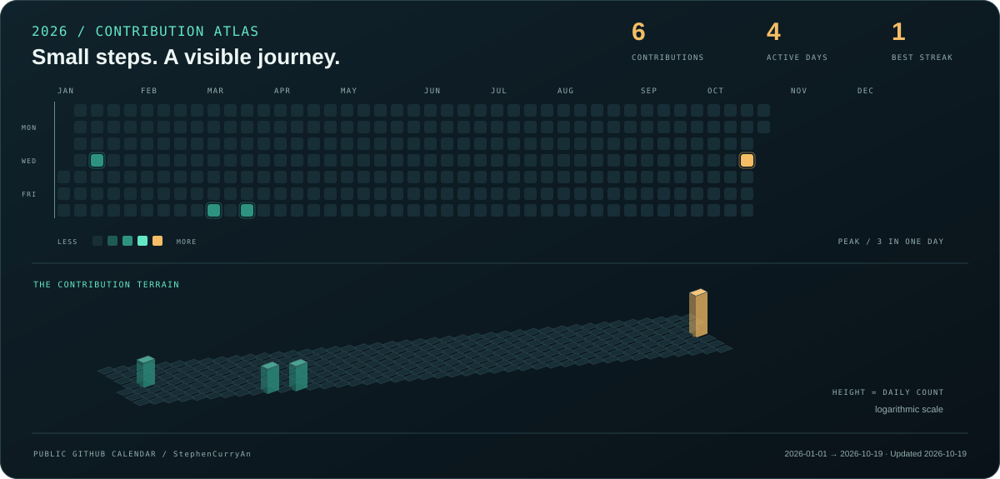

  

  <b>你好，我是安泉。</b> 
  探索 WebGIS、空间数据分析与交互式地图，让数据在地图上产生价值。

 

### 01 / TECH STACK · 我的技术栈

查看技术栈文字清单

| 方向 | 技术 |
| :--- | :--- |
| 前端与界面 | React · TypeScript · Vite · Tailwind CSS · Ant Design |
| 地图与空间数据 | MapLibre GL JS · Turf.js · AG Grid |
| 服务与编程 | Node.js · Express · Python |

 

### 02 / CONTRIBUTIONS · 每一步，都有迹可循

每个亮点，都是一次积累。数据来自 GitHub 公开贡献日历。

 

### 03 / EXPLORATION · 持续探索

- **WebGIS** — 连接地图交互与数据分析。
- **Spatial workflows** — 将地理模型服务接入在线分析流程。
- **Build & learn** — 在具体项目中学习、实现、迭代。

 

